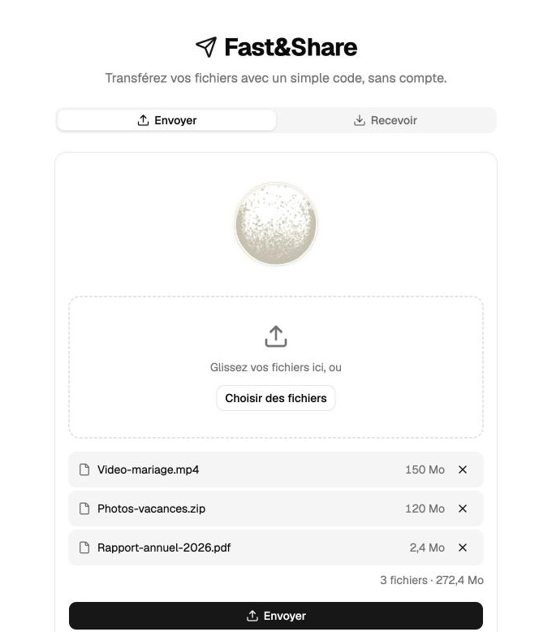
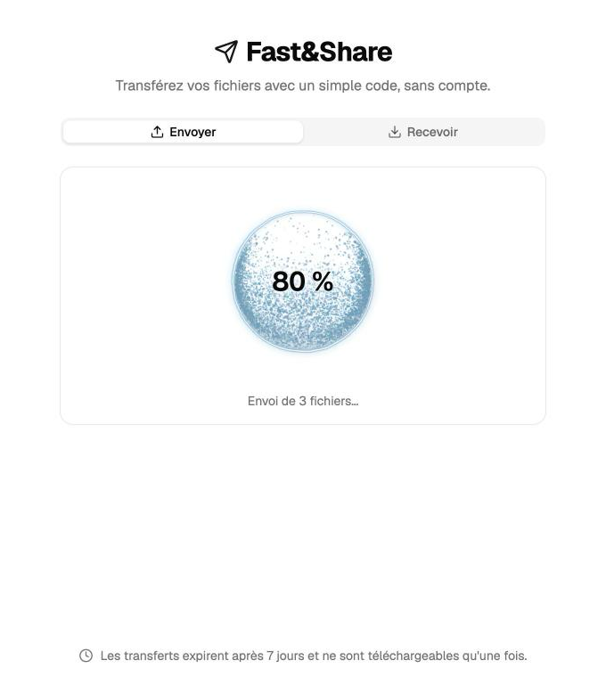
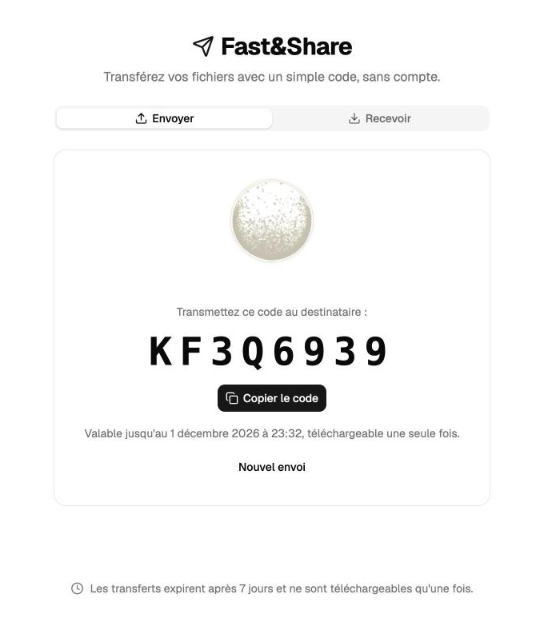
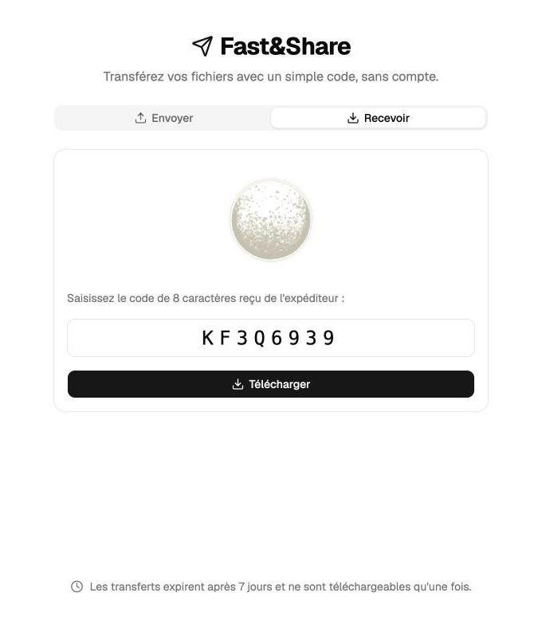
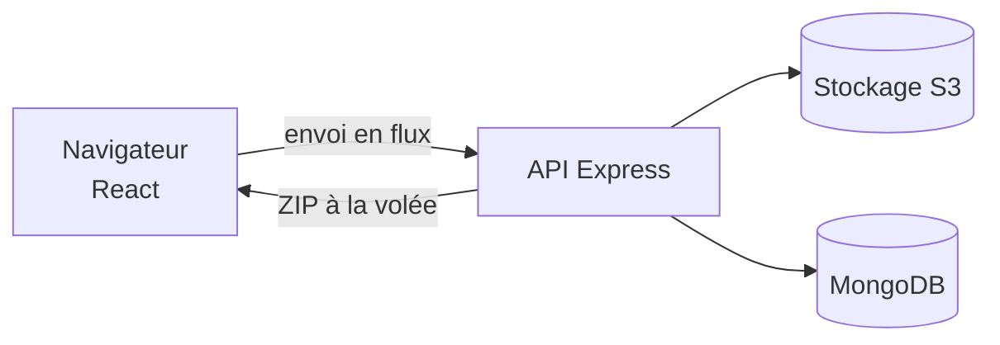

# Fast&Share

[](https://github.com/Y0AZ/fastNshare/actions/workflows/ci.yml)

**Transfert de fichiers par code, sans compte.** Déposez vos fichiers, transmettez le code de 8 caractères obtenu : le destinataire récupère un ZIP. Chaque transfert expire après 7 jours et ne se télécharge qu'une fois.

> **Statut :** MVP fonctionnel et testé en local.

| Envoi | Envoi en cours |
| --- | --- |
|  |  |
| **Code à transmettre** | **Réception** |
|  |  |

## Fonctionnalités

- Envoi par bouton ou glisser-déposer : jusqu'à 20 fichiers, 200 Mo par fichier, 500 Mo au total.
- Progression en direct dans une bulle de particules WebGL.
- Code sans caractères ambigus (ni 0, O, 1, I, L), copiable d'un clic.
- Réception en ZIP, avec des messages clairs : code inconnu, transfert expiré ou déjà téléchargé, trop de tentatives.
- Expiration réelle : les fichiers expirés sont supprimés du stockage.
- Interface accessible au clavier et aux lecteurs d'écran, adaptée au mobile.

## Architecture



- **Envoi en flux vers S3**, sans disque ni mémoire tampon : un serveur modeste accepte 500 Mo par envoi. Un envoi interrompu ne laisse aucun fichier orphelin.
- **Un seul téléchargement, même en simultané** : il est réservé par une opération atomique MongoDB avant l'envoi du ZIP, et rendu si l'envoi échoue.
- **ZIP généré à la volée**, de taille connue d'avance : le navigateur affiche un vrai pourcentage.
- **Protections :**
  - code tiré par `crypto.randomInt` parmi 852 milliards de combinaisons ;
  - 20 tentatives de téléchargement par 15 minutes et par IP ;
  - CORS limité à une liste d'origines ;
  - nettoyage protégé par jeton.

**Stack :** React 19, Vite, TypeScript, Tailwind CSS, shadcn/ui · Node.js 24, Express 5, Mongoose, AWS SDK v3 · MongoDB, stockage S3 (SeaweedFS en local) · Jest, Testcontainers, Vitest, Testing Library, GitHub Actions.

## Lancer en local

Prérequis : Node.js 24 (`nvm use`) et Docker.

```bash
git clone https://github.com/Y0AZ/fastNshare.git && cd fastNshare
docker compose up -d

cd server && cp .env.example .env && npm ci && npm run dev
```

Dans un second terminal, depuis la racine du dépôt :

```bash
cd client && cp .env.example .env && npm ci && npm run dev
```

Ouvrir http://localhost:5173. Les valeurs de `.env.example`, commentées, correspondent aux conteneurs de `docker-compose.yml`.

## Tests

`npm run check` vérifie les types, le lint, le format et lance les tests ; `test:integration` teste l'API contre un vrai MongoDB et un vrai S3 (Docker requis).

```bash
cd server
npm run check
npm run test:integration
cd ../client
npm run check
```

## Limites connues et suite

- Le ZIP est chargé en mémoire dans le navigateur avant d'être enregistré, jusqu'à 500 Mo.
- Le rate limit est compté en mémoire du serveur : il ne vaut que pour une seule instance.
- Les envois ne sont pas encore limités par IP : c'est à ajouter avant une ouverture publique.
- **À venir :** test de bout en bout (Playwright), déploiement (MongoDB Atlas, S3 managé, Render, Vercel) et nettoyage planifié.

## Crédits

Bulle de particules et indicateur de chargement : [React Bits](https://reactbits.dev) (© David Haz, licence MIT + Commons Clause, voir `client/src/components/react-bits/LICENSE.md`). Composants [shadcn/ui](https://ui.shadcn.com), icônes [Lucide](https://lucide.dev).
